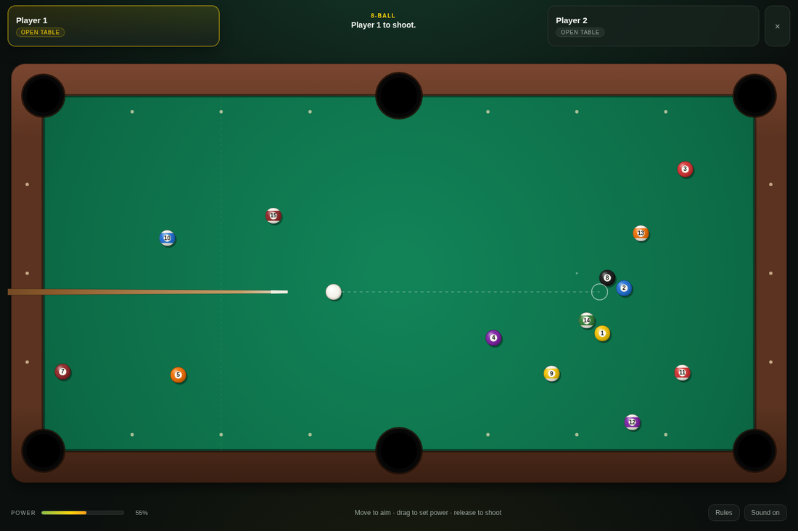
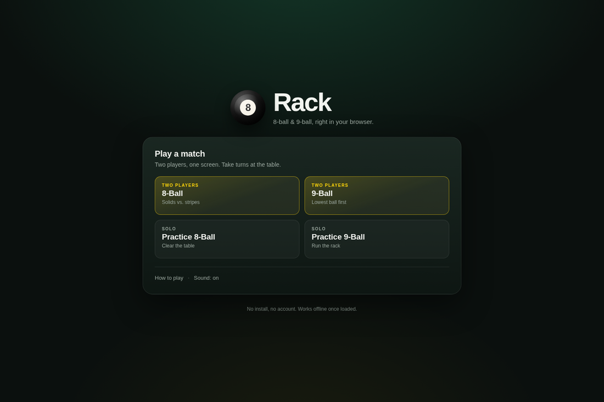
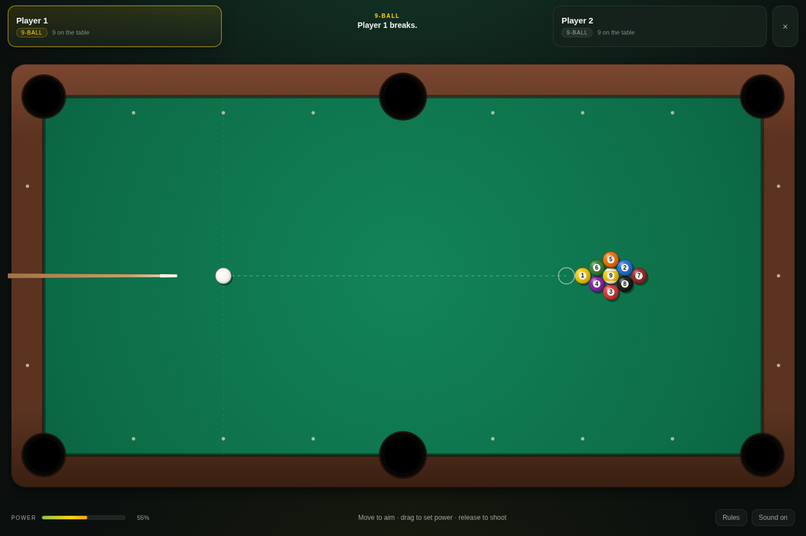
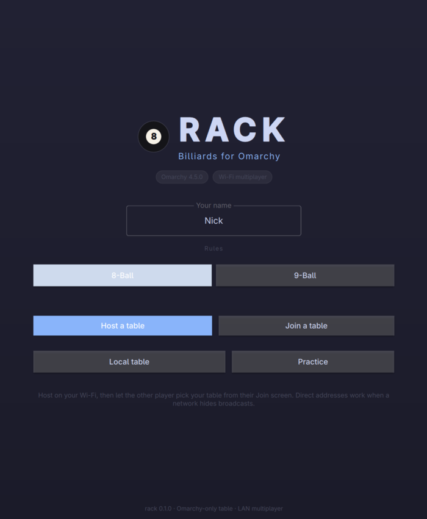
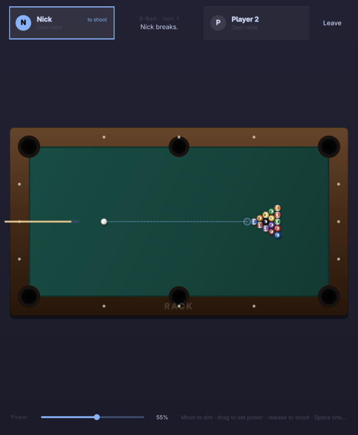
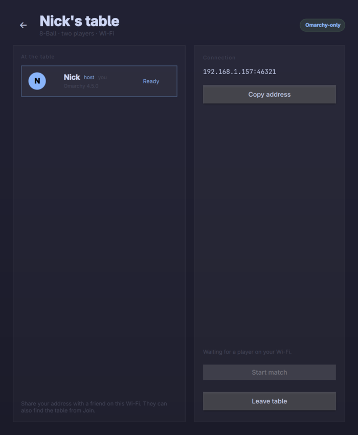
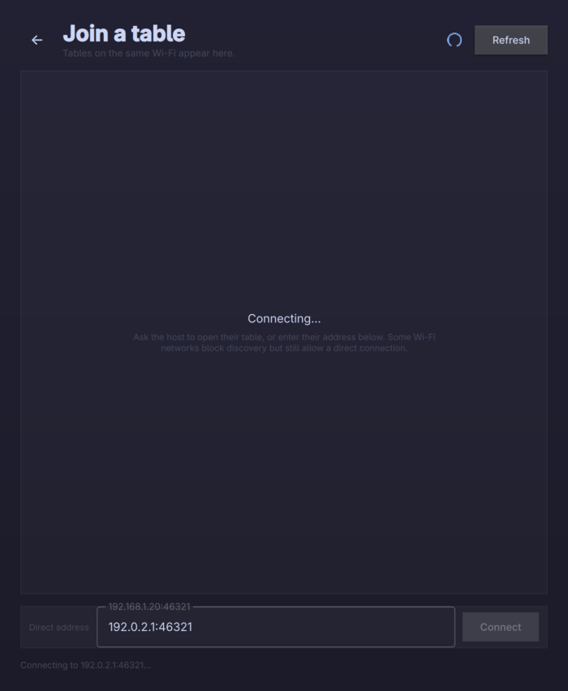

<div align="center">

# rack

**8-ball and 9-ball, right in your browser.** Two players on one screen, no
install, no account.

### [▶ Play Rack →](https://nick7612.github.io/rack/)

[Rules](docs/RULES.md) · [Desktop app](#desktop-app-optional) · [Project layout](#project-layout)

</div>



Rack is a small, self-contained billiards game. The browser build is plain
HTML, CSS, and JavaScript on a canvas: no build step, no server, and it keeps
working offline after the first visit. The same rules engine also ships as a
native Omarchy desktop app with Wi-Fi multiplayer.

## Play

Open **https://nick7612.github.io/rack/** and pick a table.

- **8-ball** — claim solids or stripes after the break, clear your group, then
  pot the 8-ball last.
- **9-ball** — always hit the lowest ball first, and pot the 9 legally at any
  time to win.
- **Two players, one screen** — take turns at the same keyboard or touchscreen.
- **Practice** — play both sides of the table and learn the angles.

The rules engine enforces the break, turn order, fouls, ball in hand, and the
win conditions. See [docs/RULES.md](docs/RULES.md) for the exact rule set.

### Controls

| Action | Control |
| --- | --- |
| Aim | Move the pointer over the table |
| Set power | Press and drag away from the cue ball |
| Shoot | Release the drag, or press `Space` |
| Fine aim | `←` / `→` (hold `Shift` for smaller steps) |
| Adjust power | `↑` / `↓` |
| Place the cue ball | Click or tap a legal spot during ball in hand |
| Leave the table | `Esc` |

On a phone or tablet the same gestures work: tap to aim, drag to set power,
release to shoot.

### Run it locally

```sh
bin/serve-web          # http://127.0.0.1:8080
node --test web/tests/*.test.mjs # rules and physics tests
```

The site is static, so any web server works. There is no npm install and no
bundler.

<table>
  <tr>
    <td></td>
    <td></td>
  </tr>
</table>

## Desktop app (optional)

The Qt 6/QML build on Omarchy adds host-authoritative Wi-Fi multiplayer, live
theme following, sounds, six languages, and an app-launcher entry.

<table>
  <tr>
    <td></td>
    <td></td>
  </tr>
  <tr>
    <td></td>
    <td></td>
  </tr>
</table>

### Install

Install the latest prebuilt release on Omarchy:

```sh
curl -fsSL https://raw.githubusercontent.com/Nick7612/rack/main/install.sh | sudo sh
```

The installer downloads the latest x86_64 release, installs the binary,
desktop entry, icon, and license, and refreshes the launcher cache. It never
compiles anything.

From a checkout, the same installer lives at the root:

```sh
sudo ./install.sh
```

If the checkout already has a `build/rack` from `bin/build`, that local build
is installed instead of downloading a release. You can also point it at a
specific archive:

```sh
sudo ./install.sh ./rack-0.1.0-x86_64.tar.gz
```

Remove it with:

```sh
sudo rm -f /usr/bin/rack \
  /usr/share/applications/rack.desktop \
  /usr/share/icons/hicolor/scalable/apps/rack.svg
sudo rm -rf /usr/share/licenses/rack
```

### Requirements

Rack runs on Omarchy with Hyprland and the Qt 6 base, declarative, multimedia,
and Wayland runtime modules; `xdg-desktop-portal` is already part of Omarchy.

Building from source also needs `qmake6`, `make`, and a C++17 compiler. The
prebuilt release is x86_64; on other architectures, build with `bin/build` and
then run `bin/install`.

### Multiplayer

One player hosts and the other joins.

1. On the first machine, choose **Host a table**, then pick 8-ball or 9-ball.
2. On the second, choose **Join a table**. The hosted table appears under
   **Tables on the same Wi-Fi**.
3. If discovery is blocked, type the address shown in the host's lobby
   (`192.168.x.x:46321`) into **Direct address** and press **Connect**.
4. Both players mark themselves **Ready**; the host starts the match.

The host is the authority. If the host leaves, the table closes. If a guest
leaves, the host can wait for someone else or leave. Chat and rematch requests
travel over the same connection.

Ports used: **TCP 46321** for the match and **UDP 46322** for discovery. Open
them if your firewall prompts.

### Omarchy-only

The desktop build is made for [Omarchy](https://omarchy.org). At startup it
checks:

1. that `/etc/os-release` reports `ID=omarchy`,
2. that the Omarchy install is present under `/usr/share/omarchy`, and
3. that the current session is Hyprland.

Hosts apply the same check to every guest through the multiplayer handshake,
so a table only opens between Omarchy systems. This is a community gate, not
copy protection: the source is open and the attestation is not signed. It keeps
normal tables honest, and it means the UI, audio, and window behavior can rely
on Omarchy being there. Run `rack --check` to see the local verdict as JSON.

The browser build has no such gate and runs anywhere.

### Build

```sh
bin/build     # qmake6 + make into build/rack
bin/test      # build and run the Qt Test suite offscreen
bin/install   # install the local build with sudo (never builds)
```

To run the local build without installing it, use `./build/rack`.

Useful development flags:

```sh
./build/rack --local --8ball           # local two-player table
./build/rack --practice --9ball        # practice table
./build/rack --host --9ball            # host on the network
./build/rack --join 192.168.1.20:46321 # join a table
./build/rack --check                   # print the Omarchy verdict as JSON
./build/rack --screenshot out.png      # render the current screen and exit
```

## Project layout

```text
web/            browser build: static HTML, CSS, and JS
  js/physics.js fixed-step ball physics and pockets
  js/game.js    rules, turns, snapshots
  js/render.js  canvas table, balls, cue, aiming guide
  js/main.js    screens and pointer/keyboard input
  tests/        Node test suite
src/            desktop backend and QML screens
  game.*        rules, turns, snapshots
  physics.*     fixed-step ball physics and pockets
  backend.*     screens, roles, match orchestration
  hostserver.*  authoritative TCP server
  gameclient.*  guest connection
  discovery.*   UDP LAN discovery
  omarchy.*     runtime attestation
  theme.*       Omarchy palette and rounding
  translator.*  JSON translation catalogs
  i18n/         en, da, de, es, fr, pt-BR
tests/          Qt Test suite
pkgbuild/       PKGBUILD, desktop entry, icon
docs/           rules and network protocol
```

## Translations

The desktop app keeps every user-facing string in `src/i18n/<code>.json`;
English falls back to the source strings. The translator follows
`~/.config/omarchy/language` and updates the running UI. To add a language, copy
`en.json`, fill in the values, add the file to `src/resources.qrc`, and add the
matching `Name[xx]` and `Comment[xx]` lines to `pkgbuild/rack.desktop`.

## Credits

The desktop project structure and Omarchy integration follow the app patterns
used by [Omacut](https://github.com/omacom-io/omacut) and
[Monologue](https://github.com/omacom-io/monologue). Rack is independent and
not an official Omarchy project.

## License

MIT. See [LICENSE](LICENSE).
