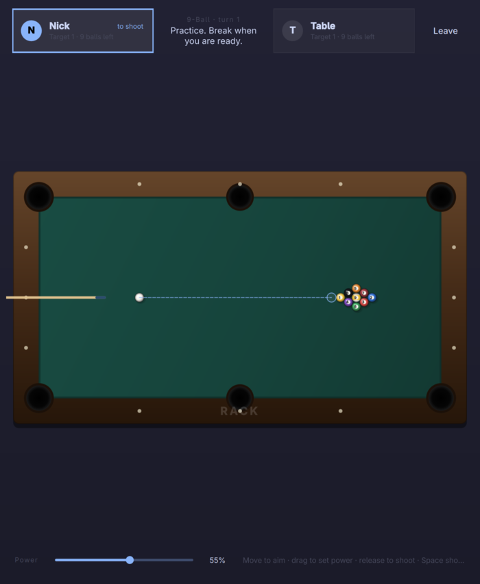

<div align="center">

# rack

**Billiards for Omarchy.** Two-player 8-ball and 9-ball over your local
network, built with Qt 6 and QML.

[Rules](docs/RULES.md) · [Protocol](docs/PROTOCOL.md) · [Building](#building)

</div>


Rack is a native desktop app, not a web page in a window. It follows your
Omarchy theme live, uses Hyprland's window rounding, and speaks plain JSON over
TCP so two machines on the same Wi-Fi can play without an account or a server.

## What it does

- **8-ball and 9-ball**, with the rack, break, turn, foul, and ball-in-hand
  rules enforced by the host. See [docs/RULES.md](docs/RULES.md) for the exact
  rule set.
- **Two players over Wi-Fi.** Host a table on one machine, join it from another
  on the same network. Discovery is automatic; a direct `host:port` field
  covers networks that block broadcast.
- **Host-authoritative physics.** The host simulates the table and streams
  state snapshots, so both players see the same shot and the same result.
- **Local and practice tables** for when you are on your own.
- **Theme-aware UI.** The app reads the Omarchy palette, accent color, and
  Hyprland corner radius, and updates while it is running.
- **Six languages** — English, Danish, German, Spanish, French, and Brazilian
  Portuguese — following the Omarchy language setting.
- **Keyboard first.** Aim with the mouse, shoot with Space, place the cue ball
  with a click, and press `?` for every shortcut.

<table>
  <tr>
    <td></td>
    <td></td>
  </tr>
  <tr>
    <td></td>
    <td></td>
  </tr>
</table>

## Omarchy-only

Rack is made for [Omarchy](https://omarchy.org). At startup it checks:

1. that `/etc/os-release` reports `ID=omarchy`,
2. that the Omarchy install is present under `/usr/share/omarchy`, and
3. that the current session is Hyprland.

Hosts apply the same check to every guest through the multiplayer handshake,
so a table only opens between Omarchy systems. This is a community gate, not
copy protection: the source is open and the attestation is not signed. It keeps
normal tables honest, and it means the UI, audio, and window behavior can rely
on Omarchy being there. Run `rack --check` to see the local verdict as JSON.

## Install

Install the latest prebuilt release on Omarchy:

```sh
curl -fsSL https://raw.githubusercontent.com/Nick7612/rack/main/install.sh | sudo sh
```

The installer downloads the latest x86_64 release, installs the binary,
desktop entry, icon, and license, and refreshes the launcher cache. It never
compiles anything.

From a checkout, the same installer lives at the root:

```sh
sudo ./install.sh
```

If the checkout already has a `build/rack` from `bin/build`, that local build
is installed instead of downloading a release. You can also point it at a
specific archive:

```sh
sudo ./install.sh ./rack-0.1.0-x86_64.tar.gz
```

Remove it with:

```sh
sudo rm -f /usr/bin/rack \
  /usr/share/applications/rack.desktop \
  /usr/share/icons/hicolor/scalable/apps/rack.svg
sudo rm -rf /usr/share/licenses/rack
```

### Requirements

Rack runs on Omarchy with Hyprland and the Qt 6 base, declarative, multimedia,
and Wayland runtime modules; `xdg-desktop-portal` is already part of Omarchy.

Building from source also needs `qmake6`, `make`, and a C++17 compiler. The
prebuilt release is x86_64; on other architectures, build with `bin/build` and
then run `bin/install`.

## Multiplayer

One player hosts and the other joins.

1. On the first machine, choose **Host a table**, then pick 8-ball or 9-ball.
2. On the second, choose **Join a table**. The hosted table appears under
   **Tables on the same Wi-Fi**.
3. If discovery is blocked, type the address shown in the host's lobby
   (`192.168.x.x:46321`) into **Direct address** and press **Connect**.
4. Both players mark themselves **Ready**; the host starts the match.

The host is the authority. If the host leaves, the table closes. If a guest
leaves, the host can wait for someone else or leave. Chat and rematch requests
travel over the same connection.

Ports used: **TCP 46321** for the match and **UDP 46322** for discovery. Open
them if your firewall prompts.

## Controls

| Action | Control |
| --- | --- |
| Aim | Move the mouse over the table |
| Set power | Drag away from the cue ball |
| Shoot | Release the drag, or press `Space` |
| Place the cue ball | Click a legal spot during ball in hand |
| Fine aim | Hold `Shift` while moving |
| Shortcuts | `?` |
| Chat | `Enter` in the chat field |
| Fullscreen | `F11` |
| Leave / close overlay | `Esc` |

## Building

```sh
bin/build     # qmake6 + make into build/rack
bin/test      # build and run the Qt Test suite offscreen
bin/install   # install the local build with sudo (never builds)
```

To run the local build without installing it, use `./build/rack`.

The build is a flat Qt project: `rack.pro` at the root, C++ and QML together in
`src/`, sounds in `sounds/`, tests in `tests/`, and packaging in `pkgbuild/`.

Useful development flags:

```sh
./build/rack --local --8ball           # local two-player table
./build/rack --practice --9ball        # practice table
./build/rack --host --9ball            # host on the network
./build/rack --join 192.168.1.20:46321 # join a table
./build/rack --check                   # print the Omarchy verdict as JSON
./build/rack --screenshot out.png      # render the current screen and exit
```

`--screenshot` is how the images above were captured. Run it under the real
Wayland session for accurate Material rendering; `QT_QPA_PLATFORM=offscreen`
works for smoke tests but drops shader effects.

## Project layout

```text
src/            C++ backend and QML screens
  game.*        rules, turns, snapshots
  physics.*     fixed-step ball physics and pockets
  backend.*     screens, roles, match orchestration
  hostserver.*  authoritative TCP server
  gameclient.*  guest connection
  discovery.*   UDP LAN discovery
  omarchy.*     runtime attestation
  theme.*       Omarchy palette and rounding
  translator.*  JSON translation catalogs
  i18n/         en, da, de, es, fr, pt-BR
tests/          Qt Test suite
pkgbuild/       PKGBUILD, desktop entry, icon
docs/           rules and network protocol
```

## Translations

Every user-facing string lives in `src/i18n/<code>.json`; English falls back to
the source strings. The translator follows `~/.config/omarchy/language` and
updates the running UI. To add a language, copy `en.json`, fill in the values,
add the file to `src/resources.qrc`, and add the matching `Name[xx]` and
`Comment[xx]` lines to `pkgbuild/rack.desktop`.

## Credits

The project structure and Omarchy integration follow the app patterns used by
[Omacut](https://github.com/omacom-io/omacut) and
[Monologue](https://github.com/omacom-io/monologue). Rack is independent and
not an official Omarchy project.

## License

MIT. See [LICENSE](LICENSE).
